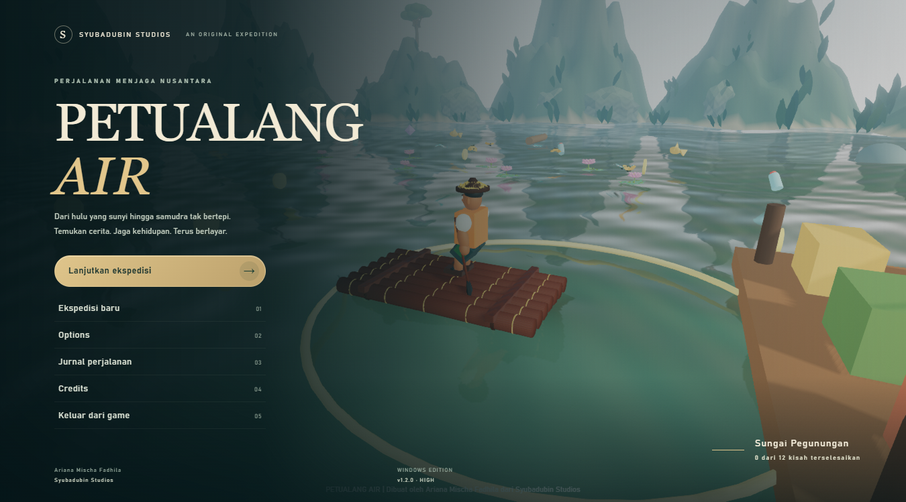
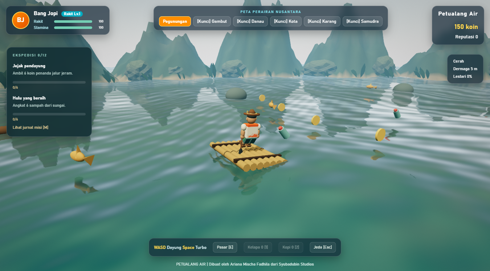

# Petualang Air

**Dibuat oleh Ariana Mischa Fadhila dari Syubadubin Studios.**

Game eksplorasi perairan Nusantara untuk Windows: enam bioma, 12 misi ekologi dan budaya, pasar terapung, rakit modular, serta perjalanan dari hulu hingga samudra.



## Bermain

Unduh installer atau paket portable dari [GitHub Releases](https://github.com/SyubadubinStudios/Petualang.Air/releases). Installer menyertakan .NET dan memasang WebView2 bila diperlukan. Windows 10 versi 2004 atau lebih baru, CPU x64, dan GPU WebGL2 diperlukan. Setelah dependensi terpasang, game dapat dimainkan offline.

Untuk menjalankan dari source, instal .NET SDK 10:

```powershell
dotnet run --project PetualangAir.Wpf
```

WASD mendayung, Space turbo, mouse mengorbit kamera, E membuka pasar, M misi, J koleksi budaya, 1/2 minuman, Escape jeda, dan F11 layar penuh. Gamepad standar juga didukung.

## Isi ekspedisi

- Enam lingkungan: jeram pegunungan, bakau gambut, danau vulkanik, kanal kota, karang, dan samudra.
- Misi, reputasi Sungai Lestari, barter, artefak budaya, kosmetik batik, dan pembukaan bioma bertahap.
- Empat rakit; jaring, lampu, bumper, kompas; kelapa dan kopi untuk stamina.
- Air berpantulan, langit atmosfer, bayangan, vegetasi bergerak, cuaca, bloom, dan preset Low–Ultra.
- Model GLB skeletal dengan animasi kayuhan, keseimbangan, idle, serta selebrasi.
- Menu utama sinematik, options yang tersimpan, scrolling credits, dan tiga soundtrack orisinal adaptif.
- Save otomatis, migrasi progres lama, serta cadangan sebelum memulai ekspedisi baru.



Visual menggunakan aset semi-realistis dan pipeline sinematik; tidak diklaim setara produksi AAA. Performa bergantung perangkat dan preset.

## Dokumentasi

| Panduan | Isi |
| --- | --- |
| [Gameplay](docs/GAMEPLAY.md) | Kontrol, misi, pasar, cuaca, dan progres |
| [Grafis & audio](docs/GRAPHICS-AUDIO.md) | Options, animasi, soundtrack, dan sumber aset |
| [Arsitektur](docs/ARCHITECTURE.md) | Modul, interop, aturan domain, dan kontribusi |
| [Pengujian](docs/TESTING.md) | Tes otomatis, uji runtime, dan screenshot |
| [Build & release](docs/RELEASE.md) | Installer, GitHub Actions, tag rilis, dan checksum |

## Build dan pengujian

```powershell
dotnet build PetualangAir.sln -c Release
dotnet test PetualangAir.sln -c Release
npm test
./tools/build-release.ps1 -Version 1.0.0
```

Node.js hanya diperlukan untuk tes JS. Blender, Python/NumPy, dan FFmpeg hanya diperlukan bila membuat ulang model atau musik. Aset GLB/Ogg dan Three.js sudah disertakan.

Workflow GitHub membangun installer/portable/checksum pada push dan PR; push tag `vMAJOR.MINOR.PATCH` menerbitkan GitHub Release. Installer game saat ini belum ditandatangani dengan sertifikat penerbit.

Source berlisensi [MIT](LICENSE). Lihat [pemberitahuan pihak ketiga](THIRD-PARTY-NOTICES.md). Workspace pengembangan: `C:\experiment\syubadubin\Petualang.Air`.
