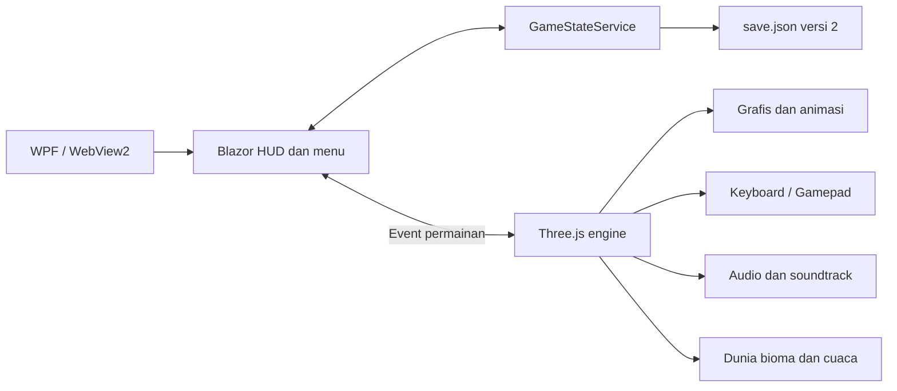

# Arsitektur dan kontribusi

## Pembagian tanggung jawab

Di Windows, WPF menangani jendela dan penyimpanan saat penutupan. Di Linux/macOS, UI Razor dan `GameStateService` yang sama dikompilasi sebagai Blazor WebAssembly (`PetualangAir.Web`) dan dijalankan dalam Electron (`desktop/`); lihat bagian [Host Linux dan macOS](#host-linux-dan-macos). Blazor mengelola UI dan aturan domain C#. Engine JS menjalankan simulasi/render loop lokal; C# menerima event koleksi, tabrakan, pergantian dermaga, telemetry satu detik, dan stamina setiap 300 ms. Interop tidak dipanggil untuk setiap vertex atau frame.

## Modul utama

| Lokasi | Tanggung jawab |
| --- | --- |
| `Services/GameStateService.cs` | Katalog 12 misi, ekonomi, inventaris, reputasi, unlock, options, migrasi, save |
| `Components/GamePage.razor` | Menu utama, HUD, pasar, jurnal, options, credits, interop |
| `wwwroot/js/petualangEngine.js` | Simulasi, buoyancy, animasi, kamera, lifecycle |
| `world.js`, `nature.js` | Bioma, GLB, rintangan, koleksi, vegetasi |
| `graphics.js` | Sky, water reflection, PBR environment, post-processing, preset |
| `weather.js`, `weatherRules.js` | Partikel dan aturan fase cuaca |
| `input.js` | Keyboard, deadzone, pemetaan gamepad, navigasi menu |
| `audio.js` | Web Audio buses, soundtrack, efek, crossfade |
| `tools/` | Pembuat aset/musik, uji runtime, pembuat installer |
| `Services/IAppShell.cs` | Operasi jendela (keluar, layar penuh, label edisi) yang disediakan tiap host |
| `PetualangAir.Web/` | Host Blazor WebAssembly: `Program.cs`, `BrowserShell`, `SaveMirror`, `index.html`, `shell.js` |
| `desktop/` | Host Electron: `main.cjs`, `preload.cjs`, uji asap, konfigurasi electron-builder |

## Aturan penting

- Harga, bahan barter, syarat dermaga, reward sekali, dan unlock divalidasi di C#.
- Counter misi dipisahkan dari stok inventaris: penjualan tidak mengurangi progres.
- Progres ditulis ke file sementara lalu diganti atomik. Save versi awal dimigrasikan tanpa mencabut bioma yang telah dikunjungi.
- Kegagalan membuat cadangan menghentikan reset ekspedisi. Reset tidak menghapus options.
- Event JS diserialkan melalui antrean. Event koleksi dengan bioma yang sudah tidak aktif diabaikan.
- Render target, geometry, material, listener, audio context, dan referensi interop dibersihkan saat lifecycle berakhir.

## Host Linux dan macOS

`PetualangAir.Web` tidak menyalin kode: komponen Razor dan `Services/` ditautkan dari `PetualangAir.Wpf`, sedangkan engine JS, CSS, model, audio, dan Three.js disalin dari `PetualangAir.Wpf/wwwroot` saat publish. Hanya `index.html` yang berbeda (memuat `blazor.webassembly.js` dan `shell.js`).

- Komponen tidak boleh memanggil API WPF secara langsung. Operasi jendela melewati `IAppShell` (`WpfShell` di Windows, `BrowserShell` di WebAssembly).
- File I/O WebAssembly berada di memori. `SaveMirror` memuat save dari host sebelum `GameStateService` dibuat, lalu menulis kembali `save.json` dan `save.json.previous` setiap kali isinya berubah. `GameStateService` sendiri tidak diubah.
- Electron menyajikan hasil publish dari origin privat `app://petualang` (tanpa port HTTP lokal) dan menulis save secara atomik ke `<appData>/PetualangAir/save.json`, format yang sama dengan Windows. Halaman berjalan dengan `contextIsolation` dan `sandbox`; preload hanya membuka baca/tulis dua file save, keluar, dan layar penuh.
- Electron dipilih karena membawa Chromium yang sama dengan WebView2, sehingga WebGL2, Web Audio, dan Gamepad API berperilaku seragam. Host berbasis WebView sistem (WebKitGTK/WKWebView) tidak dipakai karena dukungan WebGL2 dan decoding Ogg-nya bervariasi antar distribusi.

## Pengembangan

Gunakan indentasi empat spasi, PascalCase untuk C#, camelCase untuk JavaScript, dan kebab-case untuk CSS. Pertahankan nama domain Indonesia. Jangan commit `.mcp.json`, `.claude/`, save pribadi, hasil build, atau cache WebView2. Panduan awal repositori di `AGENTS.md` dipertahankan; struktur aktual dijelaskan di dokumen ini.

Dependensi Three.js dipatok pada 0.170.0 dan dibundel lokal. `Water.js` mempunyai modifikasi lokal kecil untuk membebaskan reflection render target. Lisensi aslinya tetap disertakan.
