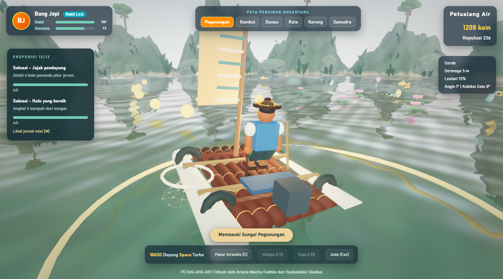
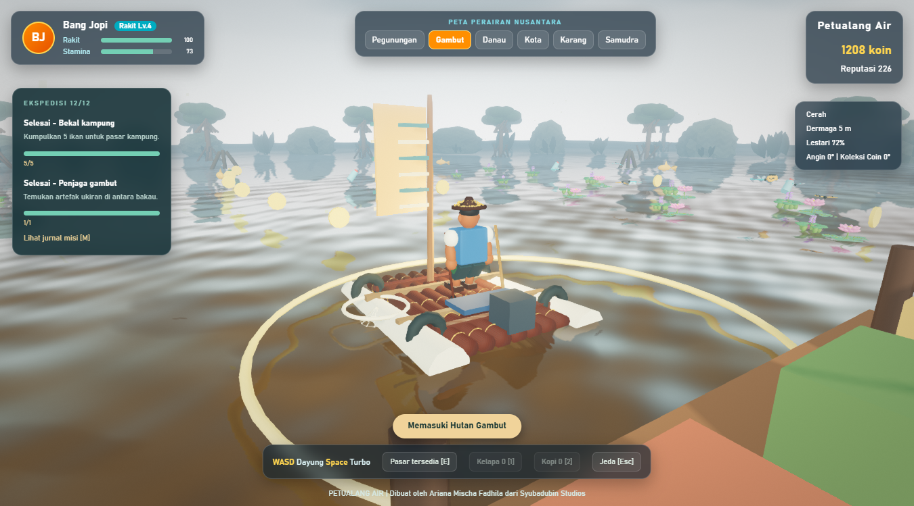
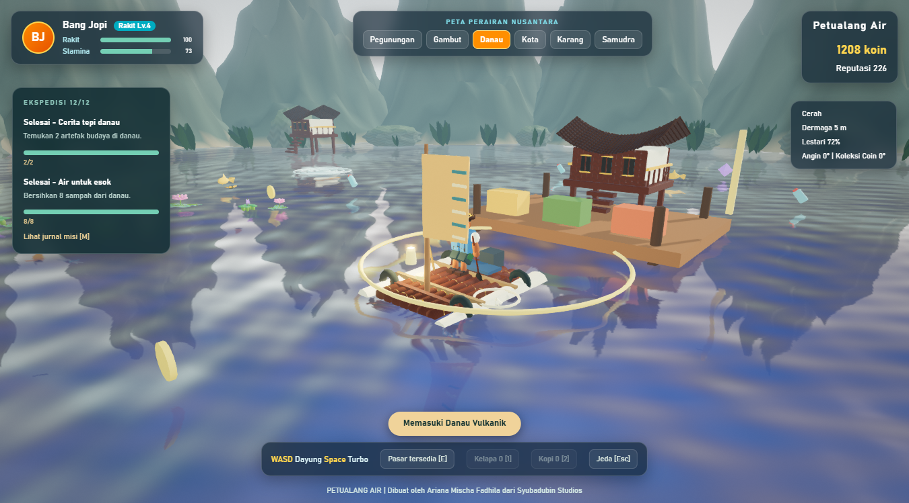
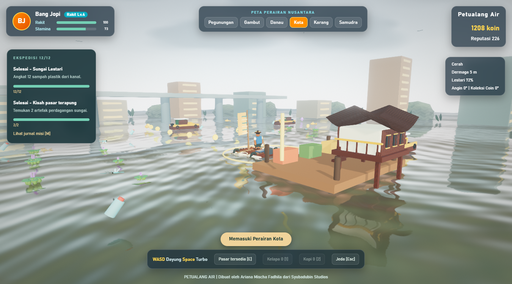
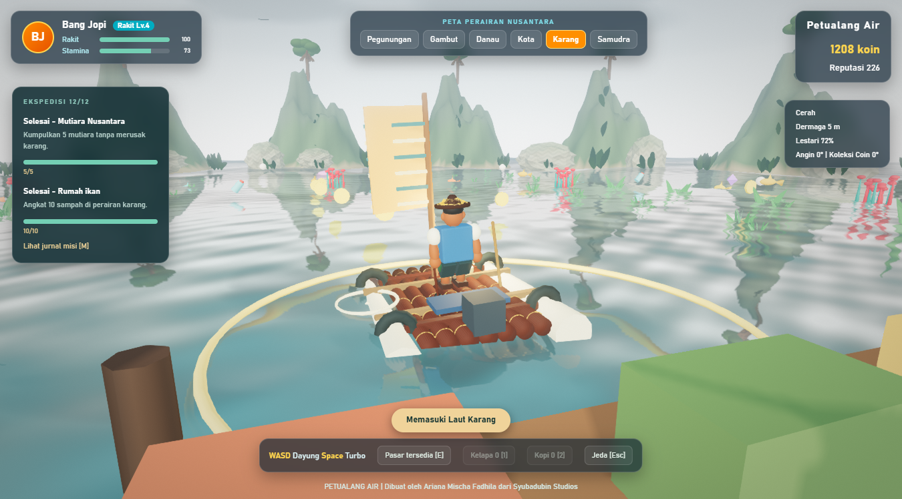
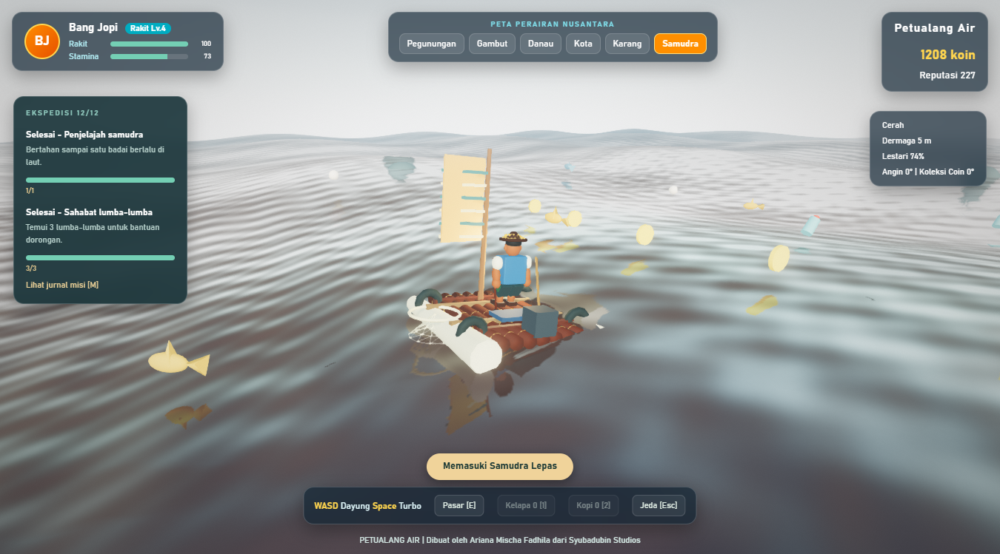

# Galeri Petualang Air v1.2.0

Dibuat oleh **Ariana Mischa Fadhila dari Syubadubin Studios**.

Screenshot diambil langsung dari game pada host Windows/WebView2 dengan preset High. Kamera diposisikan untuk memperlihatkan tiap lokasi; progres QA membuka keenam bioma. Tidak ada compositing atau gambar generatif. Tampilan dapat berbeda menurut cuaca, posisi kamera, dan preset.

## Tepian sungai pegunungan

Teratai mengapung bersama kupu-kupu dan capung yang bergerak di sekitar rumpun.

## Rawa gambut

Eceng gondok, teratai, serta serangga di antara perairan dan pepohonan bakau.

## Danau vulkanik

Dermaga dan rumah panggung dengan latar tepian danau.

## Kanal kota

Jembatan, bangunan tepi kanal, dan lalu lintas perahu klotok.

## Perairan karang

Lamun dan rumput laut di zona tepian. Air belum memiliki mode pandangan bawah permukaan.

## Samudra lepas

Rakit tingkat lanjut di perairan terbuka.

## Mengambil ulang

Gunakan save QA terpisah dan aktifkan CDP lokal port 9228. `python tools/runtime_smoke.py` memvalidasi serta membuka kampanye QA; setelah selesai, `python tools/capture_biomes.py` mengganti bioma melalui tombol UI dan menyimpan enam gambar di atas. `python tools/capture_docs.py` mengambil menu, options, credits, gameplay, dan pasar.
