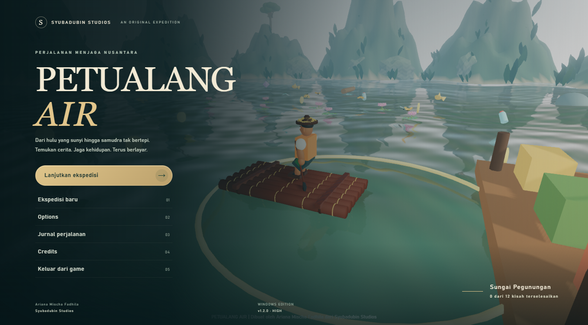
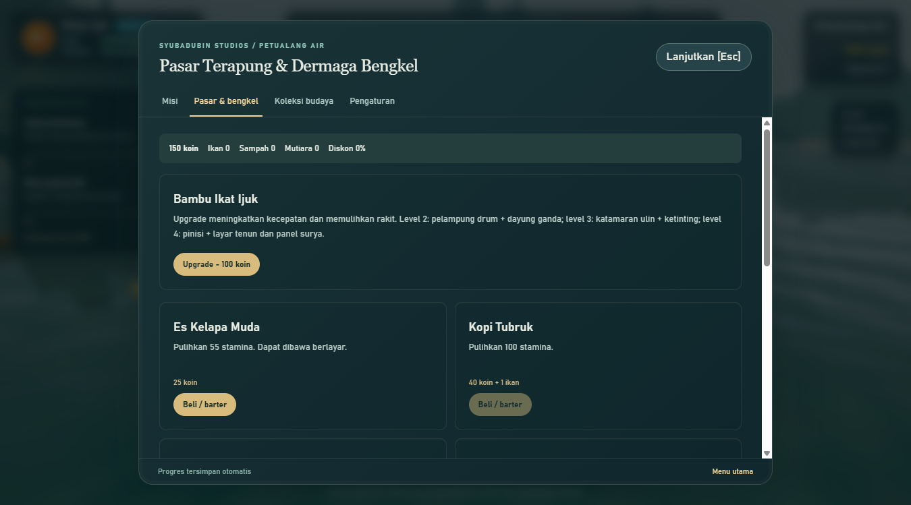

# Panduan perjalanan

Petualang Air dibuat oleh **Ariana Mischa Fadhila dari Syubadubin Studios**. Jelajahi enam perairan bersama Bang Jopi, selesaikan 12 misi, dan rawat ekosistem Nusantara.

## Memulai

Pilih **Lanjutkan ekspedisi** pada menu utama. Ikuti enam koin di depan dermaga untuk menyelesaikan misi pertama dan membuka Hutan Gambut. Misi berjalan otomatis; hadiah diterima sekali setelah target terpenuhi.

Bioma dibuka berurutan setelah misi utama bioma sebelumnya selesai. Level rakit minimum: Pegunungan 1, Gambut 1, Danau 2, Kota 2, Karang 3, Samudra 4. Tingkatkan rakit melalui pasar/bengkel; upgrade memulihkan ketahanan dan meningkatkan kecepatan.

## Kendali

| Aksi | Keyboard / mouse | Gamepad standar |
| --- | --- | --- |
| Dayung / belok | WASD atau panah | Stik kiri; RT/LT maju/mundur |
| Turbo | Space sambil maju | A sambil maju |
| Kamera | Seret mouse; roda untuk zoom | Stik kanan |
| Pasar | E | X |
| Jurnal budaya | J | Y |
| Misi | M | Tab Misi dalam menu |
| Kelapa / kopi | 1 / 2 | B untuk kelapa |
| Ganti bioma | Tombol peta | LB / RB |
| Jeda / lanjut | Escape | Start; B menutup menu |
| Layar penuh | F11 | — |
| Navigasi menu | Tab, Shift+Tab, Enter | D-pad dan A |

Klik kanvas setelah menggunakan HUD untuk mengembalikan fokus. Pada slider, D-pad kiri/kanan mengubah nilai. Gamepad harus menggunakan pemetaan **Standard Gamepad API**. Permainan dijeda saat jendela kehilangan fokus.

## Sumber daya dan pasar

Dekati koin emas, botol sampah, ikan, mutiara, serta kristal artefak ungu. Jaring meningkatkan jangkauan pengambilan ikan, sampah, dan mutiara. Sampah menaikkan reputasi dan indeks Sungai Lestari; menjualnya tidak mengurangi progres misi.

Barter dan penjualan tersedia dekat dermaga. Kompas menunjukkan arah angin dan koleksi terdekat. Lampu membantu di malam/kabut gambut; bumper mengurangi kerusakan 40%. Reputasi 40 memberi diskon 20% dan membuka pembelian Rompi Batik Lestari. Kelapa memulihkan 55 stamina, kopi 100. Minuman tidak terpakai jika stamina masih penuh.

Rakit berkembang dari bambu, bambu dengan drum/dayung ganda, katamaran bermesin ketinting, hingga pinisi dengan layar tenun dan panel surya. Saat ketahanan habis, tim dermaga memulihkan rakit gratis tanpa menghapus inventaris atau misi.

## Membaca alam

- Pegunungan: arus, batu, dan batang kayu.
- Gambut: bakau, akar, kabut, kunang-kunang, dan buaya. Buaya mengabaikan rakit yang melintas pelan tanpa turbo.
- Danau: rumah adat, pusaran, dan angin silang.
- Kota: klotok bergerak, tiang jembatan, dan misi sampah kanal.
- Karang: ikan, mutiara, terumbu, dan ubur-ubur.
- Samudra: badai dan lumba-lumba. Lumba-lumba memberikan dorongan delapan detik.

Siklus cuaca berlangsung 180 detik. Badai samudra berlangsung 50 detik; bertahan minimal 44 detik di luar dermaga dalam badai yang sama untuk menyelesaikan misinya. Menghadap ombak secara diagonal mengurangi risiko kerusakan. Kembali ke dermaga atau tenggelam membatalkan hitungan badai tersebut.

## Progres dan akhir ekspedisi

Seluruh 12 misi membuka penutup ekspedisi; pemain tetap dapat menjelajah. Artefak membuka enam catatan budaya yang merupakan narasi game terinspirasi Nusantara.

Progres tersimpan di `%AppData%/PetualangAir/save.json`. Ekspedisi baru meminta konfirmasi dalam menu dan mencadangkan save lama ke `save.json.previous`; options tetap dipertahankan. Posisi kembali ke dermaga saat aplikasi dibuka ulang.
