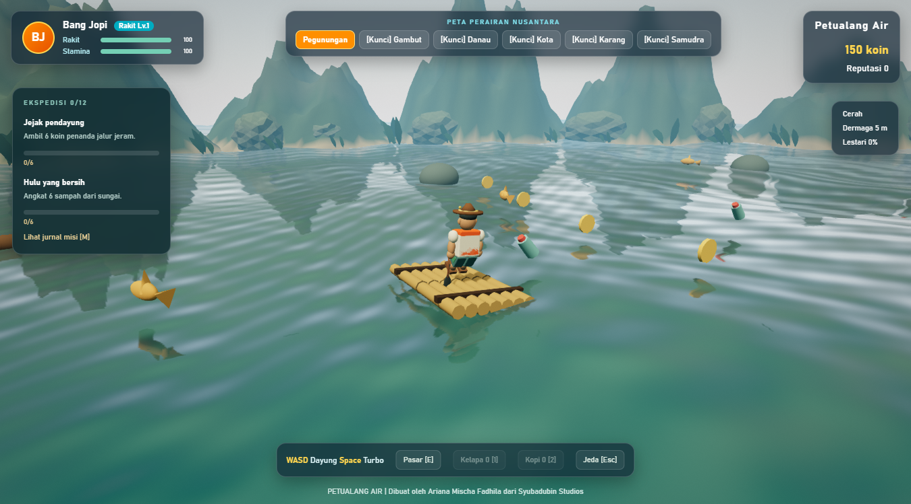
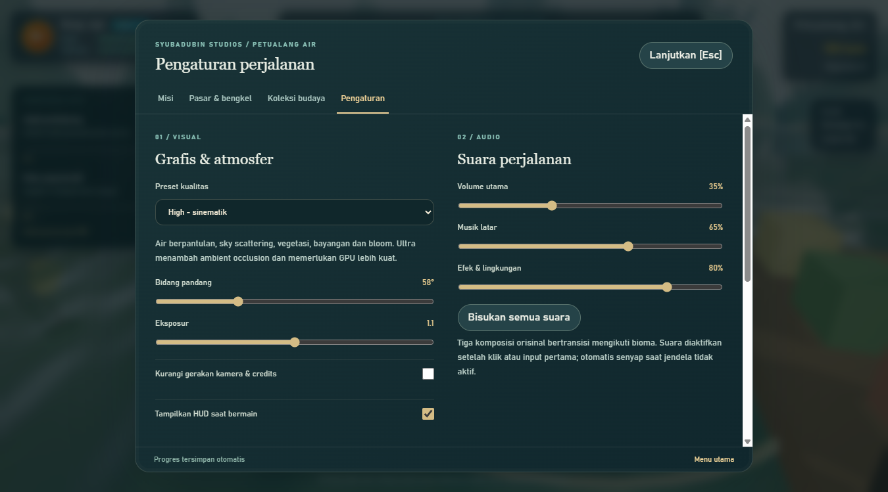
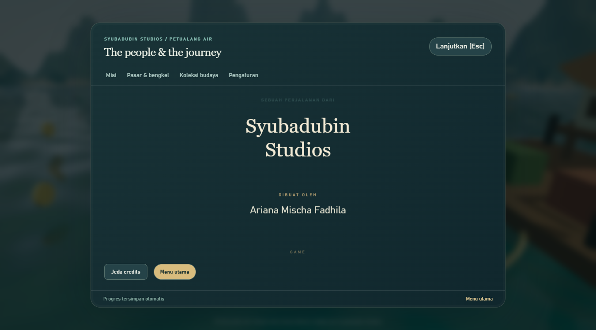

# Grafis, animasi, dan suara

## Pipeline visual

Game menggunakan Three.js/WebGL2 di WebView2. Langit atmosfer dan environment map menerangi material PBR; air menggunakan pantulan planar, normal map prosedural, gelombang, distorsi, dan buih. Terrain memiliki variasi elevasi dan warna, vegetasi instanced bergerak, burung, hujan, serta pelangi.

Post-processing menggunakan ACES tone mapping, bloom, FXAA, vignette ringan, dan grain. Preset Ultra menambahkan SSAO. Ini peningkatan sinematik pada game independen dengan aset bergaya semi-realistis, bukan klaim kualitas atau anggaran produksi AAA.



| Preset | Batas pixel ratio | Shadow map | Bloom | SSAO | Pembaruan pantulan |
| --- | --- | --- | --- | --- | --- |
| Low | 0,75 | Nonaktif | Tidak | Tidak | Setiap 4 frame |
| Medium | 1 | 1024 | Ya | Tidak | Setiap 2 frame |
| High | 1,25 | 2048 | Ya | Tidak | Setiap frame |
| Ultra | 1,5 | 2048 | Ya | Ya | Setiap frame |

Target 60 FPS bergantung GPU, resolusi, serta bioma. Turunkan preset sebelum menurunkan resolusi layar. Ultra bukan jaminan lebih cocok untuk semua perangkat; periksa respons input dan kestabilan frame.

## Options



Preset, FOV 45–90°, exposure 0,6–1,6, sensitivitas kamera gamepad, invert Y, dan visibilitas HUD dapat diubah langsung. Pengurangan gerakan menghentikan orbit otomatis menu dan mengganti credits otomatis dengan gulir manual. Semua options disimpan bersama progres. F11 beralih ke layar penuh.

Bang Jopi memakai GLB dengan skin, tujuh tulang, serta klip **Idle, Paddle, Balance, Celebrate**. AnimationMixer melakukan crossfade; turbo mempercepat kayuhan, belokan memberi counter-lean, dan artefak memicu selebrasi. Rakit memakai daya apung empat titik. Semua model dan sumber pembuatannya berada di repo.

## Musik dan efek

Tiga komposisi latar orisinal tersedia sebagai Ogg Vorbis lokal:

- **Jejak Air** — pegunungan, kota, dan karang.
- **Senja Danau** — danau dan gambut.
- **Layar Samudra** — laut lepas.

Musik melakukan crossfade saat bioma berubah. Web Audio menyintesis ambience air, tabrakan, penemuan, dan guntur; ritme memakai warna bunyi suling/gamelan/kendang sintetis, bukan rekaman instrumen tradisional. Slider master, musik, dan efek terpisah. Interaksi pengguna pertama mengaktifkan audio; jendela yang tidak aktif menjadi senyap. Musik tetap dapat dimainkan dalam menu.



## Membuat ulang aset

```powershell
blender --background --python tools/build_assets.py
python tools/build_music.py
```

Pembuatan musik membutuhkan NumPy dan FFmpeg. Pembuatan model memakai Blender (teruji dengan 5.2). Perintah ini hanya diperlukan untuk mengubah aset; build normal dan CI memakai GLB/Ogg yang telah disertakan. Sumber asli, kredit, dan dependensi dijelaskan dalam [THIRD-PARTY-NOTICES.md](../THIRD-PARTY-NOTICES.md).
