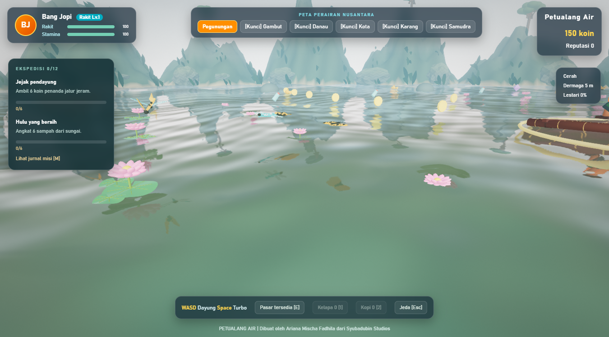

# Grafis, animasi, dan suara

## Pipeline visual

Game menggunakan Three.js/WebGL2 di WebView2. Langit atmosfer dan environment map menerangi material PBR; air menggunakan pantulan planar, normal map prosedural, gelombang, distorsi, dan buih. Terrain memiliki variasi elevasi dan warna, vegetasi instanced bergerak, burung, hujan, serta pelangi.

Post-processing menggunakan ACES tone mapping, bloom, FXAA, vignette ringan, dan grain. Preset Ultra menambahkan SSAO. Ini peningkatan sinematik pada game independen dengan aset bergaya semi-realistis, bukan klaim kualitas atau anggaran produksi AAA.


| Preset | Batas pixel ratio | Shadow map | Bloom | SSAO | Pembaruan pantulan |
| --- | --- | --- | --- | --- | --- |
| Low | 0,75 | Nonaktif | Tidak | Tidak | Setiap 4 frame |
| Medium | 1 | 1024 | Ya | Tidak | Setiap 2 frame |
| High | 1,25 | 2048 | Ya | Tidak | Setiap frame |
| Ultra | 1,5 | 2048 | Ya | Ya | Setiap frame |

Target 60 FPS bergantung GPU, resolusi, serta bioma. Turunkan preset sebelum menurunkan resolusi layar. Ultra bukan jaminan lebih cocok untuk semua perangkat; periksa respons input dan kestabilan frame.

## Options


Preset, FOV 45–90°, exposure 0,6–1,6, sensitivitas kamera gamepad, invert Y, dan visibilitas HUD dapat diubah langsung. Pengurangan gerakan menghentikan orbit otomatis menu dan mengganti credits otomatis dengan gulir manual. Semua options disimpan bersama progres. F11 beralih ke layar penuh.

Bang Jopi memakai GLB dengan skin, 13 tulang (termasuk siku, pergelangan, dan lutut), serta klip **Idle, Paddle, Balance, Celebrate**. AnimationMixer melakukan crossfade; turbo mempercepat kayuhan, belokan memberi counter-lean, dan artefak memicu selebrasi. Rakit memakai daya apung empat titik. Semua model dan sumber pembuatannya berada di repo.

## Musik dan efek

Tiga komposisi latar orisinal tersedia sebagai Ogg Vorbis lokal:

- **Jejak Air** — pegunungan, kota, dan karang.
- **Senja Danau** — danau dan gambut.
- **Layar Samudra** — laut lepas.

Musik melakukan crossfade saat bioma berubah. Web Audio menyintesis ambience air, tabrakan, penemuan, dan guntur; ritme memakai warna bunyi suling/gamelan/kendang sintetis, bukan rekaman instrumen tradisional. Slider master, musik, dan efek terpisah. Interaksi pengguna pertama mengaktifkan audio; jendela yang tidak aktif menjadi senyap. Musik tetap dapat dimainkan dalam menu.


## Membuat ulang aset

```powershell
blender --background --python tools/build_assets.py
python tools/build_music.py
```

Pembuatan musik membutuhkan NumPy dan FFmpeg. Pembuatan model memakai Blender (teruji dengan 5.2). Perintah ini hanya diperlukan untuk mengubah aset; build normal dan CI memakai GLB/Ogg yang telah disertakan. Sumber asli, kredit, dan dependensi dijelaskan dalam [THIRD-PARTY-NOTICES.md](../THIRD-PARTY-NOTICES.md).


## Aset Blender dengan detail permukaan

Seluruh aset dibuat lokal melalui Blender, tanpa Rodin atau layanan berbayar. `tools/build_assets.py` memakai `tools/asset_detail.py` untuk menghasilkan tekstur albedo, normal, dan roughness 512 px yang tertanam dalam GLB. Serat kayu, anyaman kain, rusuk caping, jahitan rompi, jari tangan, papan klotok, kusen, genteng bambu, serta ikatan dek rakit dibuat sebagai geometri atau tekstur prosedural. File `.blend` disertakan untuk penyuntingan, tetapi tidak dibawa ke installer.

| Model | Segitiga | Primitive/material group |
| --- | ---: | ---: |
| Bang Jopi | 39.040 | 9 |
| Klotok | 23.036 | 7 |
| Rumah adat | 15.336 | 5 |
| Karang | 12.624 | 2 |
| Dek rakit | 32.604 | 3 |

Model statis digabung per material. Tekstur dipakai bersama oleh salinan objek dan dilepas saat engine ditutup, bukan saat berpindah bioma. Anisotropic filtering dibatasi 8x sesuai kemampuan GPU. Arah bayangan mengikuti matahari atmosfer, dengan normal bias untuk mengurangi artefak bayangan pada permukaan.

Jalankan `python tools/validate_assets.py` untuk memeriksa anggaran setiap GLB (<12 MB, <60.000 segitiga, maksimal 12 primitive), UV, tekstur offline, skin 13 tulang, dan empat klip animasi. Validasi ini juga dijalankan dalam CI Windows. Ini bukan benchmark FPS atau jaminan kesetaraan visual AAA; wajah, deformasi sendi, dan lingkungan masih bergaya semi-realistis.


## Flora air dan serangga

Enam aset tambahan dibuat dengan Blender melalui `tools/build_ecosystem.py`; GLB dan sumber `.blend` tersedia lokal. Total GLB tambahan sekitar 514 KB. Sayap memiliki pivot tersendiri untuk kepakan; motif kupu-kupu, urat sayap capung, kelopak bunga, tulang daun, dan daun berpita dibuat sebagai geometri.

| Bioma | Tambahan |
| --- | --- |
| Pegunungan | Teratai, kupu-kupu, capung |
| Gambut | Teratai, eceng gondok, kupu-kupu, capung |
| Danau | Teratai, eceng gondok, kupu-kupu, capung |
| Kanal kota | Eceng gondok dan capung |
| Laut karang | Lamun dan rumput laut |
| Samudra | Tidak ada tambahan spesies air tawar |

Teratai dan eceng gondok mengikuti gelombang. Lamun dan rumput laut bergoyang dengan pangkal tetap, ditempatkan di zona tepian yang sebagian tampak di atas air; renderer air belum menyediakan pandangan bawah air. Serangga mengikuti lintasan terbang lokal. Semuanya dekoratif, bukan objek koleksi, rintangan, atau simulasi ekosistem biologis.

Tanaman memakai instancing per primitive. Penempatan deterministik menyisakan koridor awal rakit dan area dermaga. Instance buffer, geometri, dan material dibersihkan saat bioma dilepas.



```powershell
blender --background --python tools/build_ecosystem.py
python tools/validate_assets.py
node --test tools/habitats.test.mjs
```
